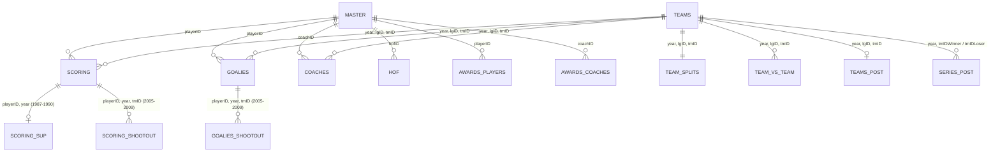

# AC-Project — Professional Hockey Data Mining & Predictive Analytics

## 1. Project Overview & Business Requirements

### Core Predictive Objectives
1. **Final Regular Season Ranking of Teams**: Predict the final regular season standings (`rank`) of all teams.
2. **Coaching Turnover Identification**: Predict the set of teams that will change head coaches from one season to the next.
3. **Third Predictive Objective**: Currently To Be Announced (TBA).

### Analysis of Requirements with the End User
- **What would be an acceptable accuracy?**
  - We use the previous season's outcome as a **persistence baseline** (*modelo de persistência*) and measure how far our predictions are from the actual values relative to that baseline.
  - Any model performing worse than the persistence baseline is considered unacceptable.
  - Formally, we can evaluate performance using a squared relative distance metric:
    $$\left(\text{dist}(\text{future}, \text{predicted}) - \text{dist}(\text{future}, \text{past})\right)^2$$
- **How long should the model take to run?**
  - No strict runtime or latency constraints.
- **What constitutes a change of coaches?**
  - We are predicting coaching changes from one season to another (off-season / pre-season turnover or any change relative to the previous season's coaching staff).
- **Should the season ranking output be a probability matrix or an absolute list from $1$ to $N$?**
  - The final output must be an **absolute ordered list of classifications** ($1$ to $N$).
- **Should the coaching change output be a probability or an absolute set?**
  - The output must be an **absolute list/set of teams** whose coaches will change.

### Definition of Business Goals
- Anticipate team performance by predicting the final regular season ranking of all teams.
- Forecast organizational instability by identifying the set of teams that will change head coaches.
- Address a third predictive objective (TBA).
- **Strict Temporal Constraint**: All predictions for season $t$ must be generated **the day before the first game of the new regular season** (preventing any data leakage from in-season games, splits, or postseason metrics of season $t$).

### Translation of Business Goals into Data Mining Goals
- **Team Standings Prediction**: Ordinal ranking / regression / classification problem leveraging historical team, roster, goaltending, and head-to-head statistics up to season $t-1$ (plus off-season roster/coaching transitions known prior to Game 1 of season $t$).
- **Coach Turnover Prediction**: Binary classification problem requiring historical analysis of coach tenure, win percentages, regular-season vs. Stanley Cup Playoff underperformance, and franchise stability.
- **Relational Feature Extraction**: The data mining pipeline must capture multi-level interactions between individual players (`Master`, `Scoring`, `Goalies`), coaching staffs (`Coaches`, `AwardsCoaches`), and franchises (`Teams`, `TeamSplits`, `TeamVsTeam`, `TeamsPost`, `SeriesPost`).

---

## 2. Dataset Architecture & Profiling Summary

The dataset (`hockey_development_data/`) comprises **22 relational CSV tables** profiled via [`profile.py`](file:///home/luis-santos/Desktop/AC/project/profile.py) into JSON (`reports/json/*.json`) and HTML (`reports/html/*.html`) exploratory reports. It spans **100 hockey seasons from 1909 to 2009** across **5 major professional leagues**:
- **NHL** (*National Hockey League*, 1917–2009) — dominant share (~86.7% to 94.3% of team/game records).
- **WHA** (*World Hockey Association*, 1972–1978) — major rival league that merged four franchises (Edmonton Oilers, Hartford Whalers, Quebec Nordiques, Winnipeg Jets) into the NHL in 1979.
- **NHA** (*National Hockey Association*, 1909–1917) — direct predecessor to the NHL.
- **PCHA** (*Pacific Coast Hockey Association*, 1911–1924) & **WCHL** (*Western Canada Hockey League*, 1921–1925) — western rival leagues whose champions competed against NHA/NHL champions in inter-league **Stanley Cup Challenge Series** prior to 1926.

> [!IMPORTANT]
> **The 2004–05 NHL Lockout Gap**: Although the temporal range spans `1909` to `2009` (101 calendar years), there are **100 unique seasons** in core tables (`Teams`, `Coaches`, `Scoring`, `Goalies`, `TeamSplits`, `TeamVsTeam`). The `2004` season (2004–05) is completely absent because the **2004–05 NHL Lockout** canceled the entire season—the first time a major North American professional sports league lost a full season to a labor dispute. Time-series lag features must treat `2003` $\rightarrow$ `2005` as consecutive played seasons while accounting for the one-year aging gap for players and coaches.

### Master Inventory of Tables (from Profiling Reports)

| Table | Rows ($n$) | Cols | Missing Cells | Year Span | Granularity / Primary Entity |
| :--- | ---: | ---: | ---: | :---: | :--- |
| [`Master.csv`](file:///home/luis-santos/Desktop/AC/project/hockey_development_data/Master.csv) | 7,469 | 31 | 38.76% | 1841–1991 (Birth) | Biographical & physical registry (`playerID`, `coachID`, `hofID`) |
| [`Teams.csv`](file:///home/luis-santos/Desktop/AC/project/hockey_development_data/Teams.csv) | 1,459 | 27 | 21.73% | 1909–2009 | Franchise regular-season standings, goals, and special teams |
| [`TeamSplits.csv`](file:///home/luis-santos/Desktop/AC/project/hockey_development_data/TeamSplits.csv) | 1,459 | 43 | 33.24% | 1909–2009 | Home/Road splits (`h*`, `r*`) and monthly performance (`Sep`–`Apr`) |
| [`TeamVsTeam.csv`](file:///home/luis-santos/Desktop/AC/project/hockey_development_data/TeamVsTeam.csv) | 23,862 | 8 | 10.28% | 1909–2009 | Head-to-head regular-season records (`tmID` vs. `oppID`) |
| [`TeamsHalf.csv`](file:///home/luis-santos/Desktop/AC/project/hockey_development_data/TeamsHalf.csv) | 41 | 11 | 0.00% | 1916–1920 | Split-season (1st half / 2nd half) standings in early NHA/NHL |
| [`TeamsPost.csv`](file:///home/luis-santos/Desktop/AC/project/hockey_development_data/TeamsPost.csv) | 895 | 17 | 15.32% | 1913–2009 | Team aggregate postseason statistics |
| [`TeamsSC.csv`](file:///home/luis-santos/Desktop/AC/project/hockey_development_data/TeamsSC.csv) | 30 | 10 | 7.33% | 1912–1925 | Inter-league Stanley Cup Finals team totals (pre-NHL exclusivity) |
| [`SeriesPost.csv`](file:///home/luis-santos/Desktop/AC/project/hockey_development_data/SeriesPost.csv) | 802 | 13 | 8.02% | 1912–2009 | Playoff series matchups, rounds, winners/losers, and goal totals |
| [`Coaches.csv`](file:///home/luis-santos/Desktop/AC/project/hockey_development_data/Coaches.csv) | 1,741 | 14 | 21.00% | 1909–2009 | Head coaching records by season, team, and coaching `stint` |
| [`Scoring.csv`](file:///home/luis-santos/Desktop/AC/project/hockey_development_data/Scoring.csv) | 43,848 | 31 | 34.14% | 1909–2009 | Skater ( and goalie) regular-season & playoff scoring by `stint` |
| [`ScoringSup.csv`](file:///home/luis-santos/Desktop/AC/project/hockey_development_data/ScoringSup.csv) | 137 | 4 | 19.34% | 1987–1990 | Supplemental full-season `PPA`/`SHA` for multi-stint traded players |
| [`ScoringSC.csv`](file:///home/luis-santos/Desktop/AC/project/hockey_development_data/ScoringSC.csv) | 284 | 10 | 0.00% | 1912–1925 | Player scoring in inter-league Stanley Cup Challenge series |
| [`ScoringShootout.csv`](file:///home/luis-santos/Desktop/AC/project/hockey_development_data/ScoringShootout.csv) | 1,487 | 7 | 0.00% | 2005–2009 | Skater shootout attempts (`S`), goals (`G`), and game-deciding goals (`GDG`) |
| [`Goalies.csv`](file:///home/luis-santos/Desktop/AC/project/hockey_development_data/Goalies.csv) | 4,096 | 23 | 30.76% | 1909–2009 | Goaltender regular-season & playoff workload, goals against, and shots |
| [`GoaliesSC.csv`](file:///home/luis-santos/Desktop/AC/project/hockey_development_data/GoaliesSC.csv) | 31 | 11 | 0.00% | 1912–1925 | Goaltender stats in inter-league Stanley Cup Challenge series |
| [`GoaliesShootout.csv`](file:///home/luis-santos/Desktop/AC/project/hockey_development_data/GoaliesShootout.csv) | 346 | 8 | 0.00% | 2005–2009 | Goaltender shootout wins, losses, shots against (`SA`), and goals against (`GA`) |
| [`CombinedShutouts.csv`](file:///home/luis-santos/Desktop/AC/project/hockey_development_data/CombinedShutouts.csv) | 50 | 8 | 0.00% | 1929–2009 | Shared shutouts (`SHO`) achieved by two goaltenders in the same game |
| [`AwardsPlayers.csv`](file:///home/luis-santos/Desktop/AC/project/hockey_development_data/AwardsPlayers.csv) | 2,021 | 6 | 22.46% | 1917–2009 | Player trophies (Hart, Norris, Vezina, Selke, Calder, etc.) & All-Star teams |
| [`AwardsCoaches.csv`](file:///home/luis-santos/Desktop/AC/project/hockey_development_data/AwardsCoaches.csv) | 75 | 5 | 20.00% | 1930–2009 | Coaching honors (Jack Adams Award, Howard Baldwin/Schmertz, All-Star) |
| [`AwardsMisc.csv`](file:///home/luis-santos/Desktop/AC/project/hockey_development_data/AwardsMisc.csv) | 120 | 6 | 19.72% | 1965–2009 | Lester Patrick Trophy recipients (outstanding service to U.S. hockey) |
| [`HOF.csv`](file:///home/luis-santos/Desktop/AC/project/hockey_development_data/HOF.csv) | 356 | 4 | 0.00% | 1945–2009 | Hockey Hall of Fame inductees (`Player`, `Builder`, `Referee/Linesman`) |
| [`abbrev.csv`](file:///home/luis-santos/Desktop/AC/project/hockey_development_data/abbrev.csv) | 58 | 3 | 0.00% | N/A | Lookup dictionary for `Conference`, `Division`, `Playoffs`, and `Round` codes |

---

## 3. Hockey Terminology & Historical Rule Regimes in the Data

A critical finding from the profiling reports (`reports/json/*.json`) is that **almost all missing values in `Teams`, `TeamSplits`, `TeamVsTeam`, `Scoring`, and `Goalies` are structurally Missing Not At Random (MNAR)**—they reflect **historical NHL rule changes, statistical tracking milestones, and playoff qualification**. Understanding hockey terminology is essential to avoid misinterpreting structural nulls or skewed distributions.

### 3.1 Standings, Points System & Game Outcomes
- **Games Played (`G` / `GP`)**: Schedule length evolved dramatically over a century, producing a bimodal/left-skewed distribution in [`Teams.csv`](file:///home/luis-santos/Desktop/AC/project/hockey_development_data/Teams.csv) ($\mu = 69.00, \text{median} = 80.0, \sigma = 19.93, \text{skew} = -1.51, \min = 1, \max = 84$). Early NHA/NHL seasons had 10–30 games; the Original Six era standardized at 70 games (1949–1966); expansion increased schedules to 74–80 games; a brief 84-game schedule ran in 1992–1993 (incorporating two neutral-site games per team); and the modern **82-game schedule** began in 1995 (with 1994 shortened to 48 games by a lockout). Note: the $\min = 1$ outlier in `Teams.G` is the **1917 Montreal Wanderers (`MWN`)**, who played 1 game before the Montreal Arena burned down.
- **Regulation & Overtime Ties (`T`)**: Present from `1909` to `2003` ($\mu = 9.02, \sigma = 4.97$). Completely missing (`10.3%` missing in `Teams` and `TeamSplits`, i.e., all 150 team-seasons in `2005–2009`) after the NHL abolished tie games following the 2004–05 lockout.
- **Overtime Losses (`OTL` / `OL` / `T/OL`) & The "Loser Point"**: Introduced in the **1999–2000 season (`year = 1999`)** when the NHL adopted 4-on-4 regular-season overtime and awarded **1 point** to a team losing in overtime (or shootout from 2005 onward). Consequently, `OTL` is missing in `79.6%` of `Teams` and `TeamSplits` rows (all seasons prior to 1999), and averages $\mu = 6.96$ ($\sigma = 3.52$, range $0\text{–}18$) between 1999 and 2009.
- **Shootout Wins (`SoW`), Shootout Losses (`SoL`), and Game-Deciding Goals (`GDG`)**: Introduced in **2005–06 (`year = 2005`)** to break post-overtime ties. In `Teams.csv`, `SoW` and `SoL` are missing in `89.7%` of rows (populated only in `2005–2009`, where both average $\mu = 5.39$). Dedicated tables [`ScoringShootout.csv`](file:///home/luis-santos/Desktop/AC/project/hockey_development_data/ScoringShootout.csv) ($n = 1,487$) and [`GoaliesShootout.csv`](file:///home/luis-santos/Desktop/AC/project/hockey_development_data/GoaliesShootout.csv) ($n = 346$) track individual shootout attempts (`S`), goals (`G`), and shootout game-deciding goals (`GDG`). Note that in hockey rules, shootout goals and saves **do not count** toward regular-season `G`, `A`, `Pts`, `SOG`, or goalie `SA`/`GA`, though a team's `SoW` is included in total wins (`W`) and adds to `GF` in team standings.
- **Standings Points (`Pts`)**: Calculated across eras as:
  $$\text{Pts} = \begin{cases} 2W + T & \text{(1909–1998)} \\ 2W + T + \text{OTL} & \text{(1999–2003, where } W \text{ includes OT wins)} \\ 2W + \text{OTL} & \text{(2005–2009, where } W \text{ includes OT and } \text{SoW, and } \text{OTL} \text{ includes OT and } \text{SoL)} \end{cases}$$
  In `Teams.csv`, `Pts` has $\mu = 70.43, \text{median} = 74.0, \sigma = 26.35$, reaching a historical peak of $\max = 132$ (the **1976–77 Montreal Canadiens**, `60-8-12`).
- **Divisional vs. League Rank (`rank`)**: A crucial finding from profiling [`Teams.csv`](file:///home/luis-santos/Desktop/AC/project/hockey_development_data/Teams.csv) is that `rank` ranges only from **$1$ to $10$** ($\mu = 3.23, \text{median} = 3.0, \sigma = 1.68$). Verification against `(year, lgID, divID)` confirms that **`rank` is 100% the team's standing within its Division (`divID`)** (or within the league during single-division eras like the Original Six), **not** the overall 1–30 league-wide standing. In the modern 6-division era (`1998–2009`, 30 teams across `AT`, `NE`, `SE`, `CE`, `NW`, `PC`), `rank` is strictly $1\text{–}5$ inside each division.

### 3.2 Special Teams & On-Ice Situations
- **Even Strength & Plus/Minus (`+/-`)**: Tracks a skater's on-ice goal differential at even strength (and short-handed): $+1$ when on the ice for an even-strength or short-handed goal for, $-1$ when on the ice for an even-strength or short-handed goal against (power-play goals and penalty shots are excluded). Tracked officially by the NHL starting in **1967–68** (`22.1%` missing in `Scoring.csv`). Because every goal at even strength produces five $+1$s and five $-1$s, `+/-` is centered near zero ($\mu = -0.30, \text{median} = 0.0, \sigma = 11.83$), with extreme historic outliers from **Bill Mikkelson** ($\min = -82$ on the 1974–75 expansion Washington Capitals) to **Bobby Orr** ($\max = +124$ in 1970–71 with Boston).
- **Power Play (`PP`)**: When an opponent serves one or more minor/major penalties, giving the attacking team a man-advantage (e.g., 5-on-4 or 5-on-3).
  - **`PPG` (Power Play Goals)** & **`PPC` (Power Play Chances/Opportunities)**: Populated in `Teams.csv` from **1963–2009** (`28.6%` missing). Team `PPG` averages $\mu = 63.56$ ($\sigma = 16.56$) on $\mu = 335.52$ opportunities (`PPC`), yielding an average historical **Power Play Percentage ($\text{PP\%} = \text{PPG}/\text{PPC}$)** of **~18.9%**.
  - **`PPA` (Power Play Assists)**: Skater assists on power-play goals in `Scoring.csv` (`52.3%` missing, as situational assists were tracked much later than `PPG`).
- **Penalty Kill (`PK`) & Short-Handed (`SH`) Play**: Playing with fewer skaters due to a penalty.
  - **`PKG` (Power Play Goals Allowed)** & **`PKC` (Penalty Kill Chances / Times Short-Handed)**: By conservation of goals across a league season, league-wide `PKG` mirrors `PPG` ($\mu = 63.56, \sigma = 17.03$) on $\mu = 335.62$ `PKC` ($\text{PK\%} = 1 - \text{PKG}/\text{PKC} \approx 81.1\%$).
  - **`SHF` / `SHG` (Short-Handed Goals For)** & **`SHA` (Short-Handed Goals Allowed in `Teams.csv` / Short-Handed Assists in `Scoring.csv`)**: Scoring while short-handed is a rare event. In `Teams.csv`, `SHF` and `SHA` both average $\mu = 8.88$ per season. In `Scoring.csv`, `SHG` has **68.9% zeros** ($\mu = 0.26, \text{skew} = 4.52$), with the all-time single-season record $\max = 13$ held by **Wayne Gretzky** (`1983–84`).
  - **The `SHA` Naming Collision**: Note that in [`Teams.csv`](file:///home/luis-santos/Desktop/AC/project/hockey_development_data/Teams.csv) and [`TeamsPost.csv`](file:///home/luis-santos/Desktop/AC/project/hockey_development_data/TeamsPost.csv), `SHA` denotes **Short-Handed Goals Against** (allowed while on the power play), whereas in [`Scoring.csv`](file:///home/luis-santos/Desktop/AC/project/hockey_development_data/Scoring.csv) and [`ScoringSup.csv`](file:///home/luis-santos/Desktop/AC/project/hockey_development_data/ScoringSup.csv), `SHA` denotes **Short-Handed Assists** by a skater!
- **Penalty Minutes (`PIM`) & Bench Minors (`BenchMinor`)**:
  - `PIM` measures physical play, fighting Majors (5 mins), Misconducts (10 mins), and Minor penalties (2 mins). In `Scoring.csv`, `PIM` is heavily right-skewed ($\mu = 35.72, \text{median} = 20.0, \sigma = 44.80, \text{skew} = 2.39$), peaking at $\max = 472$ (**Dave "The Hammer" Schultz**, 1974–75 Philadelphia Flyers *"Broad Street Bullies"*).
  - `BenchMinor` in `Teams.csv` (`33.7%` missing, tracked 1969–2009, $\mu = 15.69$) tracks team-assessed 2-minute penalties (most commonly **"Too Many Men on the Ice"** or unsportsmanlike conduct from the bench), a subtle proxy for coaching bench discipline.

### 3.3 Goaltending & Netminding Metrics
- **Minutes Played (`Min`), Goals Against (`GA`), Shots Against (`SA`)**: In [`Goalies.csv`](file:///home/luis-santos/Desktop/AC/project/hockey_development_data/Goalies.csv), `SA` is missing in `38.9%` of rows because the NHL only began officially tracking Shots on Goal (`SOG` / `SA`) in **1955–56** (and consistently across all leagues later). From `Min`, `GA`, and `SA`, the two primary rate statistics in hockey analytics can be derived:
  - **Goals Against Average ($\text{GAA}$)**: $\text{GAA} = \frac{\text{GA} \times 60}{\text{Min}}$ (normalized to a 60-minute regulation game).
  - **Save Percentage ($\text{SV\%}$)**: $\text{SV\%} = \frac{\text{SA} - \text{GA}}{\text{SA}} = 1 - \frac{\text{GA}}{\text{SA}}$.
- **Shutouts (`SHO`) & [`CombinedShutouts.csv`](file:///home/luis-santos/Desktop/AC/project/hockey_development_data/CombinedShutouts.csv)**: A goalie earns a shutout (`SHO`) by playing the entire game and allowing zero goals. In `Goalies.csv`, `SHO` is zero-inflated (**50.6% zeros**, $\mu = 1.41, \text{skew} = 2.41, \max = 22$ by **George Hainsworth** in just 44 games in 1928–29 during the forward-pass restriction era). When two goalies share a shutout in the same game (typically due to an injury), neither goalie is credited with an individual `SHO` in `Goalies.csv`; instead, the event is logged in [`CombinedShutouts.csv`](file:///home/luis-santos/Desktop/AC/project/hockey_development_data/CombinedShutouts.csv) ($n = 50$ games from 1929–2009: 49 Regular Season `R`, 1 Playoff `P`).
- **Empty-Net Goals (`ENG`)**: When trailing by 1–2 goals in the final minutes, a coach pulls the goaltender for a **6th attacker** (extra skater). Goals scored into the unguarded net are charged to the team's `GA` (in `Teams.csv`) and tracked separately in `Goalies.ENG` ($\mu = 1.67, \max = 12$, `18.2%` missing), but are **not** charged against a goaltender's personal `GA` or `GAA`.

---

## 4. Detailed Analysis of Core Tables & Distributions

### 4.1 Franchise & Team Performance (`Teams`, `TeamSplits`, `TeamVsTeam`, `TeamsHalf`, `TeamsPost`, `SeriesPost`)
- **Symmetry of League Scoring (`GF` vs. `GA`)**: In [`Teams.csv`](file:///home/luis-santos/Desktop/AC/project/hockey_development_data/Teams.csv) ($n = 1,459$), Goals For (`GF`) and Goals Against (`GA`) have identical means ($\mu = 218.44$) and medians ($228.0$), with standard deviations of $79.34$ (`GF`) and $80.60$ (`GA`). Both peak at $\max = 446$:
  - $\max(\text{GF}) = 446$: **1983–84 Edmonton Oilers** (high-flying 1980s run-and-gun era led by Gretzky, Messier, Coffey, Kurri).
  - $\max(\text{GA}) = 446$: **1974–75 Washington Capitals** (expansion team that went `8-67-5`).
- **Home-Ice Advantage (`TeamSplits.csv`)**: Profiling [`TeamSplits.csv`](file:///home/luis-santos/Desktop/AC/project/hockey_development_data/TeamSplits.csv) ($n = 1,459$) reveals a pronounced **home-ice advantage** (driven by last-change line-matching privileges for the home coach, reduced travel fatigue, and faceoff rules):
  - **Home Wins (`hW`)**: $\mu = 18.06, \text{median} = 19.0, \sigma = 6.86$ vs. **Home Losses (`hL`)**: $\mu = 11.72, \text{median} = 12.0, \sigma = 5.60$.
  - **Road Wins (`rW`)**: $\mu = 12.39, \text{median} = 12.0, \sigma = 5.96$ vs. **Road Losses (`rL`)**: $\mu = 17.32, \text{median} = 18.0, \sigma = 6.57$.
  - Across a century of professional hockey, home teams win **~56.2%** of decided games!
- **Monthly Seasonality (`TeamSplits.csv`)**:
  - `SepW`/`SepL`/`SepOL` are **99.9% missing** (`SepT` is **100% missing** and flagged as `Unsupported` by the profiler) because only 2 team-seasons in history played regular-season games in September.
  - `Oct` (`21.9%` missing) and `Nov` (`11.0%` missing) are missing in early-20th-century seasons when the schedule began in December or January (`Jan` has only `0.3%` missing and `Feb` has `0.6%` missing).
  - `Apr` (`34.3%` missing) is only populated in modern longer schedules or lockout-delayed seasons.
- **Head-to-Head Matrix (`TeamVsTeam.csv`)**: Contains $23,862$ directed pair records (`tmID` vs. `oppID`). Because every pairing is recorded from both teams' perspectives, `W` ($\mu = 1.86$) and `L` ($\mu = 1.78$) are nearly symmetric, with `19.2%` zeros in `W` and `21.6%` zeros in `L`.
- **Early Split-Season & Challenge Era (`TeamsHalf`, `TeamsSC`, `SeriesPost`)**:
  - [`TeamsHalf.csv`](file:///home/luis-santos/Desktop/AC/project/hockey_development_data/TeamsHalf.csv) ($n = 41$, `1916–1920`) captures the early NHA/NHL format where seasons were divided into `half = 1` and `half = 2`, and the winners of each half met in the league championship. Notice `T` has a constant value of `0` across all 41 rows.
  - [`SeriesPost.csv`](file:///home/luis-santos/Desktop/AC/project/hockey_development_data/SeriesPost.csv) ($n = 802$) logs every playoff series. Note `note = 'TG'` ($56$ series) indicates **Total Goals** two-game aggregate series used in early rounds before best-of-5 (`W = 3`) and best-of-7 (`W = 4`, $604$ series or $75.3\%$) became standard; `note = 'ND'` ($1$ series) marks the **1919 Stanley Cup Finals** between the Montreal Canadiens and Seattle Metropolitans, halted with No Decision due to the **Spanish Influenza epidemic**.

### 4.2 Coaching Dynamics & Turnover (`Coaches.csv` & `AwardsCoaches.csv`)
[`Coaches.csv`](file:///home/luis-santos/Desktop/AC/project/hockey_development_data/Coaches.csv) contains $1,741$ coach-team-season-stint records across $384$ distinct coaches (`coachID`) and $1,459$ team-seasons:
- **In-Season Coaching Changes (`stint`)**:
  - `stint = 1`: $1,455$ records ($83.6\%$) — season-opening head coach.
  - `stint = 2`: $251$ records ($14.4\%$) — first mid-season replacement coach (indicating the season-opening coach was fired, resigned, or promoted mid-season).
  - `stint = 3`: $35$ records ($2.0\%$) — second mid-season replacement (three coaches in a single season!).
  - Notice that $1,459$ team-seasons in `Teams.csv` vs. $1,455$ `stint = 1` rows in `Coaches.csv` occurs because in 4 team-seasons, co-coaches or anomalies occurred, and in `notes` ($99.4\%$ missing), 9 coaches are explicitly tagged as `interim` and 2 as `co-coach`.
- **The Single Missing Regular-Season Record in `Coaches.csv`**:
  - Exactly 1 row out of $1,741$ (`0.1%`) has missing regular-season `g`, `w`, `l`, `t`: **`martija02c` (Jacques Martin), `2001` Ottawa Senators (`OTT`), `stint = 3`**, who has `postg = 12, postw = 7, postl = 5`. In 2001–02, Jacques Martin (`stint = 1`, 80 games) stepped aside for the final 2 regular-season games so assistant coach **Roger Neilson** (`neilsro01c`, `stint = 2`, 2 games), who had terminal cancer, could reach 1,000 career NHL games coached; Martin then resumed head coaching duties (`stint = 3`) for the playoffs!
- **Postseason Qualification (`postg`, `postw`, `postl`, `postt`)**: Missing in **48.6%** ($846$ rows) of `Coaches.csv`, corresponding to coaches whose teams missed the playoffs or who were fired mid-season before the playoffs began.
- **Jack Adams Award Paradox (`AwardsCoaches.csv`)**: Contains $75$ rows ($36$ NHL `Jack Adams` trophies, $32$ early `First/Second Team All-Star` coach selections, $5$ WHA `Howard Baldwin`/`Schmertz` awards). In hockey analytics, the **Jack Adams Award** (voted on after the regular season for the coach adjudged to have contributed the most to his team's success) is famously correlated with teams riding unsustainable PDO (high shooting % + high save %) after a poor prior season—often followed by regression and coaching dismissal within 2–3 seasons.

### 4.3 Skater Scoring & Roster Granularity (`Scoring`, `ScoringSup`, `Goalies`)
- **Extreme Right-Skewness & Zero-Inflation in Skater Scoring (`Scoring.csv`, $n = 43,848$)**:
  - Because rosters include **enforcers/goons**, **defensive defensemen (stay-at-home D)**, **fourth-line grinders**, **short-term AHL call-ups**, and **goaltenders**, offensive statistics exhibit heavy positive skewness:
    - **Goals (`G`)**: $29.2\%$ zeros, $\text{median} = 3.0, \mu = 7.29, \sigma = 9.86, \text{skew} = 1.97, \max = 92$ (Wayne Gretzky, 1981–82).
    - **Assists (`A`)**: $20.7\%$ zeros, $\text{median} = 6.0, \mu = 11.53, \sigma = 13.90, \text{skew} = 1.76, \max = 163$ (Wayne Gretzky, 1985–86).
    - **Points (`Pts`)**: $17.3\%$ zeros, $\text{median} = 10.0, \mu = 18.82, \sigma = 22.59, \text{skew} = 1.71, \max = 215$ (Wayne Gretzky, 1985–86).
    - **Game-Winning Goals (`GWG`)**: $46.6\%$ zeros, $\text{median} = 0.0, \mu = 1.00, \text{skew} = 2.35, \max = 16$.
    - **Game-Tying Goals (`GTG`)**: $53.6\%$ zeros, $35.9\%$ missing (obsolete after ties were eliminated in 2005).
- **Mid-Season Trades (`stint`) & [`ScoringSup.csv`](file:///home/luis-santos/Desktop/AC/project/hockey_development_data/ScoringSup.csv)**:
  - In `Scoring.csv`, `stint = 1` ($40,241$ rows, $91.8\%$) represents a player's first team in a season, while `stint = 2` ($3,463$), `stint = 3` ($141$), and `stint = 4` ($3$) represent subsequent teams after mid-season **trades** or **waiver claims**.
  - Between `1987` and `1990`, the NHL recorded Power Play Assists (`PPA`) and Short-Handed Assists (`SHA`) as full-season totals rather than splitting them by team for traded players. All $137$ rows in [`ScoringSup.csv`](file:///home/luis-santos/Desktop/AC/project/hockey_development_data/ScoringSup.csv) correspond **100%** to multi-stint (`stint >= 2`) players from `1987–1990` whose `PPA` and `SHA` are blank in `Scoring.csv`.
- **Playoff-Only "Black Aces" (Missing Regular-Season `GP` in `Scoring` & `Goalies`)**:
  - In `Scoring.csv`, $263$ rows ($0.6\%$) have missing regular-season `GP`, `G`, `A`, `Pts`, `PIM`. Inspection confirms that **$260$ of these $263$ rows have non-null `PostGP`** (players recalled from junior/minor leagues after the regular season ended—known in hockey as **"Black Aces"**—who dressed exclusively in the Stanley Cup Playoffs). The remaining $3$ rows (`cleghsp01` 1920 OTS, `gerared01` 1921 TRS, `morribe01` 1919 SEA) were players who appeared exclusively in the inter-league Stanley Cup Challenge Finals ([`ScoringSC.csv`](file:///home/luis-santos/Desktop/AC/project/hockey_development_data/ScoringSC.csv)).
  - Similarly, in `Goalies.csv`, all $20$ rows ($0.5\%$) with missing regular-season `GP` have `PostGP >= 1` (playoff-only emergency/backup goaltenders).

### 4.4 Player & Coach Demographics (`Master.csv`, $n = 7,469$)
- **Entity Overlap**: Of the $7,469$ individuals in `Master.csv`, $7,236$ ($96.9\%$) have a `playerID`, $392$ ($5.2\%$) have a `coachID`, and $361$ ($4.8\%$) have a `hofID`. Notably, $159$ individuals have **both** a `playerID` and a `coachID` (former NHL/WHA players who later became head coaches), a valuable feature for coaching pedigree!
- **Physical Attributes**: `height` ($\mu = 71.87\text{ in} \approx 6'0'', \sigma = 2.32, \min = 63\text{ in} \text{ [Roy Worters, } 5'3''], \max = 81\text{ in} \text{ [Zdeno Chára, } 6'9'']$) and `weight` ($\mu = 189.32\text{ lbs}, \sigma = 18.40, \min = 125, \max = 265$) follow near-normal distributions ($\text{skew} = -0.10$ and $0.08$).
- **Handedness (`shootCatch`)**: Unlike the general population (~90% right-handed), **65.3% of hockey players shoot/catch Left (`L`: $4,604$ vs. `R`: $2,441$, plus $1$ ambidextrous `B`)** because coaching convention in Canada/Europe places the dominant hand at the top of the stick for superior stickhandling and poke-checking control, causing right-handed dominant individuals to shoot left.
- **Geographic Concentration**: Canada accounts for **72.5%** of all players with known birthplaces ($5,250$, led by Ontario `ON` with $2,333$ and Quebec `QC` with $892$), followed by the USA ($953$, $13.2\%$), Sweden ($216$), and the Czech Republic ($203$).

---

## 5. Critical Data Quality Alerts & Anomalies from Profiling Reports

When building preprocessing pipelines from these tables, the following anomalies flagged in `reports/json/*.json` must be handled explicitly:

1. **Sentinel Value `9999.0` in `Master.deathYear`**:
   - The profiling report for [`Master.json`](file:///home/luis-santos/Desktop/AC/project/reports/json/Master.json) flags `deathYear` with an anomalous mean of $2548.83$, standard deviation of $2054.48$, and maximum of $9999.0$.
   - **Root Cause**: Exactly **93 rows** in `Master.csv` use `deathYear = 9999.0` as a sentinel code meaning *"known to be deceased, exact year of death unknown"*. Any calculation of age or lifespan must filter out `deathYear == 9999.0`.
2. **100% Missing / Constant Columns Flagged as Rejected**:
   - `AwardsCoaches.note`: **100.0% missing** ($75/75$ rows empty).
   - `TeamSplits.SepT`: **100.0% missing** ($1,459/1,459$ rows empty); `SepW`, `SepL`, `SepOL` are **99.9% missing** (only 2 non-null rows).
   - `AwardsMisc.award` (constant `'Patrick'`) and `AwardsMisc.lgID` (constant `'NHL'`).
   - `TeamsHalf.T` (constant `'0'`).
3. **Code Collisions in [`abbrev.csv`](file:///home/luis-santos/Desktop/AC/project/hockey_development_data/abbrev.csv)**:
   - `abbrev.csv` contains $58$ rows across 4 types (`Conference`, `Division`, `Playoffs`, `Round`), but only $49$ distinct `Code` values because codes like `CF`, `CQF`, `CSF`, `DF`, `DSF`, `F`, `QF`, `SCSF`, `SF` appear under **both** `Type = 'Playoffs'` (for `Teams.playoff`) and `Type = 'Round'` (for `SeriesPost.round`). Always join `abbrev.csv` on `(Type, Code)` rather than `Code` alone!
4. **Franchise Relocations (`tmID` vs. `franchID`)**:
   - [`Teams.csv`](file:///home/luis-santos/Desktop/AC/project/hockey_development_data/Teams.csv) has **$114$ distinct `tmID` codes** across **$65$ distinct `franchID` codes**. When franchises relocate or rename (e.g., Quebec Nordiques `QUE` $\rightarrow$ Colorado Avalanche `COL` under `franchID = 'QUE'`; Winnipeg Jets `WIN` $\rightarrow$ Phoenix Coyotes `PHO`; Hartford Whalers `HAR` $\rightarrow$ Carolina Hurricanes `CAR`; Minnesota North Stars `MNS` $\rightarrow$ Dallas Stars `DAL`), `tmID` changes while `franchID` remains constant. **All year-over-year persistence baselines and lag features must group by `franchID` (or map `tmID` via `franchID`), not `tmID` alone!**
5. **High Multicollinearity Alerts**:
   - The profiler flags heavy collinearity across counting stats:
     - In `Teams.csv`: `G` correlates strongly with `W`, `L`, `Pts`, `GF`, `GA`, `PIM`, `PPG`, `PPC`, `PKG`, `PKC` simply because season length (`G`) scales all volume totals from 10–30 games in the 1910s to 82–84 games in the modern era.
     - **Remediation**: Normalize all team, coach, and player volume metrics into **per-game (`/ G` or `/ GP`)** or **percentage (`Pts%`, `PP%`, `PK%`, `SV%`)** rates before training models across multiple eras.

---

## 6. Modeling & Feature Engineering Recommendations for Business Goals

To respect the **strict pre-season temporal constraint** (predicting on the day before Game 1 of season $t$) and beat the **persistence baseline** (*modelo de persistência*):

### 6.1 Objective 1: Predicting Final Regular Season Team Rankings (`rank`)
- **Clarify Target Scope (`divID` vs. League)**: Since `Teams.rank` is strictly divisional standing ($1\text{–}5$ in modern NHL divisions), models should predict expected **Points Percentage ($\text{Pts\%} = \frac{\text{Pts}}{2G}$)** or **Goal Differential per Game ($\frac{\text{GF} - \text{GA}}{G}$)** and then rank teams **within each `(year, lgID, divID)` bucket** to produce an exact $1\text{ to }N$ integer permutation.
- **Pythagorean Expectation & Luck Regression**:
  - In hockey analytics, teams whose actual points percentage exceeds their **Pythagorean Expectation** ($\frac{\text{GF}^\gamma}{\text{GF}^\gamma + \text{GA}^\gamma}$, with exponent $\gamma \approx 2.05$) or who have unsustainable records in one-goal games, overtime (`OTL`), shootouts (`SoW`/`SoL`), or late-season months (`Feb`–`Apr` in `TeamSplits.csv`) tend to regress toward their underlying goal/shot differential in season $t$.
- **Roster Turnover & Net Talent Delta (Pre-Season Known Features)**:
  - Although season $t$'s games have not been played, a team's **opening-night roster** can be approximated (or evaluated once rosters are known) by aggregating lagged player metrics (`Scoring.csv`, `Goalies.csv`, `AwardsPlayers.csv`, and player age from `Master.birthYear` where peak hockey performance is ages $24\text{–}28$) from season $t-1$.

### 6.2 Objective 2: Predicting Coaching Changes
- **Distinguishing Off-Season vs. Mid-Season Changes**:
  - Using `Coaches.csv`, a coaching change between season $t-1$ and season $t$ can occur either:
    1. **Off-season change**: The coach who finished season $t-1$ (highest `stint` in $t-1$) is not the `stint = 1` coach in season $t$.
    2. **In-season firing during season $t$**: The team has `max(stint) >= 2` in season $t$ (occurring in $\sim 16.4\%$ of team-seasons historically).
- **High-Signal Predictors for Coach Instability**:
  - **Standings Underperformance (`Delta Rank` & `Delta Pts%`)**: Year-over-year drop in `Pts%` or divisional `rank` between $t-2$ and $t-1$.
  - **Playoff Disappointment (`Teams.playoff` & `SeriesPost.csv`)**: High regular-season finish (`rank = 1` or `2`) followed by missing the playoffs or a first-round exit (`CQF` / `DSF` / `PRE`).
  - **Coach Tenure & Age ("Shelf Life")**: Number of consecutive seasons the `coachID` has been behind the bench for the same `franchID` (NHL coaches historically face diminishing returns and rising dismissal risk after 3–4 seasons without a deep playoff run).
  - **Late-Season Collapse (`TeamSplits.csv`)**: Poor win percentage in `Feb` and `Mar` of season $t-1$ relative to `Oct`–`Dec`.
  - **Mid-Season Interim Tag**: Whether the coach finishing season $t-1$ entered via `stint >= 2` or had `notes = 'interim'`.

---

## 7. Formal Mathematical Formulation of Hockey Rule Regimes & Structural Changes

To model a century of hockey data without introducing era-induced bias or data leakage, all historical rule changes, statistical tracking milestones, and table relationships can be expressed as formal mathematical partitions, functional identities, and conservation laws.

### 7.1 Discrete Temporal Domain & The Lockout Operator
Let $\mathcal{T}$ denote the ordered set of active professional hockey seasons in the dataset:
$$\mathcal{T} = \{1909, 1910, \dots, 2003\} \cup \{2005, 2006, 2007, 2008, 2009\}, \qquad |\mathcal{T}| = 100$$
Because the $2004\text{–}05$ season ($t = 2004$) was canceled due to the NHL lockout, the **lag (predecessor) operator** $\pi: \mathcal{T} \setminus \{1909\} \to \mathcal{T}$ is piecewise:
$$\pi(t) = \begin{cases} t - 1, & \text{if } t \in \mathcal{T} \setminus \{1909, 2005\} \\ 2003, & \text{if } t = 2005 \end{cases}$$
Consequently, while the **season index step** is always $\Delta n = 1$, the **chronological elapsed time** (which governs player/coach biological aging $\text{Age}_{p,t} = t - \text{birthYear}_p$) is:
$$\Delta t = t - \pi(t) = 1 + \mathbb{I}(t = 2005) \in \{1, 2\}$$

---

### 7.2 Structural Regimes of Game Outcomes & Standings Points

Let $(f, i, l, t)$ index a franchise $f \in \mathcal{F}$ (`franchID`), team code $i \in \mathcal{I}_{l,t}$ (`tmID`), league $l \in \mathcal{L}_t$ (`lgID`), and season $t \in \mathcal{T}$. The century of play partitions into **three mutually exclusive rule regimes** $\mathcal{T} = \mathcal{T}_{\text{I}} \sqcup \mathcal{T}_{\text{II}} \sqcup \mathcal{T}_{\text{III}}$:

#### Regime I: Classical Two-Point / Tie Era ($\mathcal{T}_{\text{I}} = \{t \in \mathcal{T} : 1909 \le t \le 1998\}$)
- **Game Partition Identity**:
  $$G_{i,t} = W_{i,t} + L_{i,t} + T_{i,t}$$
  *(Note: In split-season years $t \in [1916, 1920]$ recorded in `TeamsHalf.csv`, overtime was played until a winner was decided or ties were absent, yielding $T_{i,t} = 0$.)*
- **Structural Nulls**:
  $$\text{OTL}_{i,t} = \varnothing, \qquad \text{SoW}_{i,t} = \varnothing, \qquad \text{SoL}_{i,t} = \varnothing$$
- **Standings Points Functional**:
  $$\text{Pts}_{i,t} = 2 W_{i,t} + 1 T_{i,t}$$
- **Strict Zero-Sum Points Conservation**: Every game $m$ allocates exactly $2$ standings points between the two competing teams ($2+0$ for a decision or $1+1$ for a tie). Summing across all teams in league $l$:
  $$\sum_{i \in \mathcal{I}_{l,t}} \text{Pts}_{i,t} = 2 \sum_{i \in \mathcal{I}_{l,t}} W_{i,t} + \sum_{i \in \mathcal{I}_{l,t}} T_{i,t} = \sum_{i \in \mathcal{I}_{l,t}} \left(W_{i,t} + L_{i,t} + T_{i,t}\right) = \sum_{i \in \mathcal{I}_{l,t}} G_{i,t}$$

#### Regime II: Overtime Loss ("Loser Point") & Tie Era ($\mathcal{T}_{\text{II}} = \{t \in \mathcal{T} : 1999 \le t \le 2003\}$)
In $1999\text{–}2000$, the NHL introduced 4-on-4 regular-season overtime and awarded $1$ point to a team losing in overtime ($\text{OTL}$), while retaining ties ($T$) if the 5-minute overtime ended scoreless:
- **Game Partition Identity**:
  $$G_{i,t} = W_{i,t} + L_{i,t} + T_{i,t} + \text{OTL}_{i,t}$$
  where $W_{i,t} = W^{\text{reg}}_{i,t} + W^{\text{OT}}_{i,t}$ includes both regulation and overtime wins, and $L_{i,t} = L^{\text{reg}}_{i,t}$ counts **strictly regulation losses**.
- **Structural Nulls**:
  $$\text{SoW}_{i,t} = \varnothing, \qquad \text{SoL}_{i,t} = \varnothing$$
- **Standings Points Functional**:
  $$\text{Pts}_{i,t} = 2 W_{i,t} + 1 T_{i,t} + 1 \text{OTL}_{i,t}$$
- **Non-Zero-Sum Points Inflation**: Any game decided in overtime awards $2$ points to the winner and $1$ point to the loser ($3$ points total instead of $2$). Thus, total league points strictly exceed total games played by the number of overtime decisions:
  $$\sum_{i \in \mathcal{I}_{l,t}} \text{Pts}_{i,t} = \sum_{i \in \mathcal{I}_{l,t}} G_{i,t} + \sum_{i \in \mathcal{I}_{l,t}} \text{OTL}_{i,t} > \sum_{i \in \mathcal{I}_{l,t}} G_{i,t}$$

#### Regime III: Post-Lockout Shootout Era ($\mathcal{T}_{\text{III}} = \{t \in \mathcal{T} : 2005 \le t \le 2009\}$)
Following the $2004\text{–}05$ lockout, tie games were abolished via the introduction of the penalty-shot **Shootout** (`ScoringShootout.csv`, `GoaliesShootout.csv`):
- **Structural Nulls**:
  $$T_{i,t} = \varnothing \quad (\text{identically } 0)$$
- **Game Partition & Hierarchical Decomposition**:
  $$G_{i,t} = W_{i,t} + L_{i,t} + \text{OTL}_{i,t}$$
  where wins and overtime/shootout losses decompose into:
  $$W_{i,t} = W^{\text{reg}}_{i,t} + W^{\text{OT}}_{i,t} + \text{SoW}_{i,t}, \qquad \text{OTL}_{i,t} = L^{\text{OT}}_{i,t} + \text{SoL}_{i,t}$$
- **Standings Points Functional**:
  $$\text{Pts}_{i,t} = 2 W_{i,t} + 1 \text{OTL}_{i,t}$$
- **Points Inflation Law**: Every game that remains tied after 60 minutes of regulation (whether decided in 4-on-4 OT or the shootout) awards $3$ total standings points ($2$ to the winner, $1$ to the loser):
  $$\sum_{i \in \mathcal{I}_{l,t}} \text{Pts}_{i,t} = \sum_{i \in \mathcal{I}_{l,t}} G_{i,t} + \sum_{i \in \mathcal{I}_{l,t}} \left(L^{\text{OT}}_{i,t} + \text{SoL}_{i,t}\right)$$

---

### 7.3 Schedule Length Step Function & Era-Invariant Normalization

The scheduled number of regular-season games per team $G^{\text{sched}}_{l,t}$ in the NHL is a piecewise step function of time:
$$G^{\text{sched}}_{\text{NHL}, t} = \begin{cases}
10 \le G_t \le 44, & 1917 \le t \le 1941 \quad (\text{Early expansion \& pre-WWII eras}) \\
50 \text{ or } 60, & 1942 \le t \le 1948 \quad (\text{WWII \& early post-war era}) \\
70, & 1949 \le t \le 1966 \quad (\text{Original Six era, } |\mathcal{I}_{\text{NHL},t}| = 6) \\
74 \le G_t \le 78, & 1967 \le t \le 1973 \quad (\text{First expansion wave, } 12 \to 16 \text{ teams}) \\
80, & 1974 \le t \le 1991 \quad (\text{70s/80s expansion \& WHA merger}) \\
84, & 1992 \le t \le 1993 \quad (\text{Neutral-site game experiment}) \\
48, & t = 1994 \quad (\text{1994–95 lockout-shortened season}) \\
82, & t \in [1995, 2009] \setminus \{2004\} \quad (\text{Modern 82-game standard})
\end{cases}$$

Because extensive counting statistics $X_{i,t} \in \{W, L, T, \text{OTL}, \text{Pts}, \text{GF}, \text{GA}, \text{PIM}, \text{PPG}, \text{PPC}, \text{PKG}, \text{PKC}\}$ scale linearly with $G_{i,t}$ ($\mathbb{E}[X_{i,t}] \propto G_{i,t}$), comparing raw counts across seasons violates distributional stationarity. Furthermore, scoring environments shifted across eras (e.g., League $\mu(\text{GF}/G) \approx 7.9\text{–}8.0$ in the 1980s vs. $\approx 5.2\text{–}5.5$ in the late-1990s *"Dead Puck Era"*).

To construct **stationary, era-invariant features**:
1. **Rate / Intensive Normalization**:
   $$\tilde{X}_{i,t} = \frac{X_{i,t}}{G_{i,t}}, \qquad \text{Pts\%}_{i,t} = \frac{\text{Pts}_{i,t}}{2 G_{i,t}} \in [0, 1]$$
2. **Within-Season Z-Score Standardization** (removes both schedule length $G_t$ and era scoring/points-inflation shifts):
   $$Z_{i,t}(X) = \frac{\tilde{X}_{i,t} - \mu_{l,t}(\tilde{X})}{\sigma_{l,t}(\tilde{X})}, \quad \text{where } \mu_{l,t}(\tilde{X}) = \frac{1}{|\mathcal{I}_{l,t}|}\sum_{j \in \mathcal{I}_{l,t}} \tilde{X}_{j,t}$$

---

### 7.4 League-Wide Conservation Laws & Cross-Table Accounting Identities

1. **Conservation of Goals (`Teams.csv`)**:
   In any closed league-season $(l, t)$, total Goals For equals total Goals Against:
   $$\sum_{i \in \mathcal{I}_{l,t}} \text{GF}_{i,t} = \sum_{i \in \mathcal{I}_{l,t}} \text{GA}_{i,t} \implies \sum_{i \in \mathcal{I}_{l,t}} \left(\text{GF}_{i,t} - \text{GA}_{i,t}\right) = 0$$
2. **Reconciliation of Team Goals vs. Individual Skater & Goalie Goals**:
   Let $\mathcal{P}_{i,t}$ be the set of skaters (`Scoring.csv`) and $\mathcal{G}_{i,t}$ be the set of goaltenders (`Goalies.csv`) appearing for team $i$ in season $t$.
   - For $t \in \mathcal{T}_{\text{I}} \cup \mathcal{T}_{\text{II}}$ (pre-shootout):
     $$\text{GF}_{i,t} = \sum_{p \in \mathcal{P}_{i,t}} G_{p,i,t}, \qquad \text{GA}_{i,t} = \sum_{g \in \mathcal{G}_{i,t}} \text{GA}_{g,i,t} + \sum_{g \in \mathcal{G}_{i,t}} \text{ENG}_{g,i,t}$$
   - For $t \in \mathcal{T}_{\text{III}}$ (Shootout Era, $2005\text{–}2009$):
     Under NHL statistical rules, the winner of a shootout is credited with $+1$ team goal in `Teams.GF` (and the loser with $+1$ team goal against in `Teams.GA`), whereas individual shootout goals (`ScoringShootout.G`) and shootout goals against (`GoaliesShootout.GA`) are **excluded** from `Scoring.G` and `Goalies.GA`:
     $$\text{GF}_{i,t} = \sum_{p \in \mathcal{P}_{i,t}} G_{p,i,t} + \text{SoW}_{i,t}, \qquad \text{GA}_{i,t} = \sum_{g \in \mathcal{G}_{i,t}} \text{GA}_{g,i,t} + \sum_{g \in \mathcal{G}_{i,t}} \text{ENG}_{g,i,t} + \text{SoL}_{i,t}$$
3. **Special Teams Duality ($t \ge 1963$)**:
   Every Power Play Goal (`PPG`) scored by one team is simultaneously a Penalty Kill Goal Allowed (`PKG`) by its opponent, and every Short-Handed Goal For (`SHF`) is a Short-Handed Goal Allowed (`Teams.SHA`) by its opponent:
   $$\sum_{i \in \mathcal{I}_{l,t}} \text{PPG}_{i,t} = \sum_{i \in \mathcal{I}_{l,t}} \text{PKG}_{i,t}, \qquad \sum_{i \in \mathcal{I}_{l,t}} \text{PPC}_{i,t} = \sum_{i \in \mathcal{I}_{l,t}} \text{PKC}_{i,t}, \qquad \sum_{i \in \mathcal{I}_{l,t}} \text{SHF}_{i,t} = \sum_{i \in \mathcal{I}_{l,t}} \text{SHA}^{\text{team}}_{i,t}$$
   Team Special Teams efficiencies and the **Bowman Special Teams Index** ($\text{STI}$) are defined as:
   $$\text{PP\%}_{i,t} = \frac{\text{PPG}_{i,t}}{\text{PPC}_{i,t}}, \qquad \text{PK\%}_{i,t} = 1 - \frac{\text{PKG}_{i,t}}{\text{PKC}_{i,t}}, \qquad \text{STI}_{i,t} = \text{PP\%}_{i,t} + \text{PK\%}_{i,t}$$
   where a league-average team satisfies $\mathbb{E}[\text{STI}_{i,t}] = 1.00$ ($100\%$).
4. **Spatiotemporal Decomposition (`TeamSplits.csv` & `TeamVsTeam.csv`)**:
   - **Home/Road Partition**: For each outcome $X \in \{W, L, T, \text{OTL}\}$:
     $$X_{i,t} = hX_{i,t} + rX_{i,t}, \quad \text{with } \sum_{i \in \mathcal{I}_{l,t}} hW_{i,t} = \sum_{i \in \mathcal{I}_{l,t}} \left(rL_{i,t} + r\text{OTL}_{i,t}\right)$$
   - **Monthly Partition**: Across calendar months $\mathcal{M} = \{\text{Sep}, \text{Oct}, \text{Nov}, \text{Dec}, \text{Jan}, \text{Feb}, \text{Mar}, \text{Apr}\}$:
     $$X_{i,t} = \sum_{m \in \mathcal{M}} X^{(m)}_{i,t}$$
   - **Reciprocal Head-to-Head Matrix (`TeamVsTeam.csv`)**: For any ordered pair $(i, j) \in \mathcal{I}_{l,t}^2$ ($i \neq j$):
     $$W_{i,j,t} = L_{j,i,t} + \text{OTL}_{j,i,t}, \qquad T_{i,j,t} = T_{j,i,t}, \qquad X_{i,t} = \sum_{j \in \mathcal{I}_{l,t} \setminus \{i\}} X_{i,j,t}$$

---

### 7.5 Structural Evolution of Divisions, Conferences & The Target Ranking Operator

Let $\mathcal{D}_{l,t} = \{d_1, d_2, \dots, d_{M_{l,t}}\}$ be the partition of the teams $\mathcal{I}_{l,t}$ into $M_{l,t}$ divisions (`divID`), and $\mathcal{C}_{l,t}$ be the partition into conferences (`confID`):
$$M_{\text{NHL}, t} = |\mathcal{D}_{\text{NHL}, t}| = \begin{cases}
1 \; (\text{divID} = \varnothing), & t \in [1917, 1925] \cup [1938, 1966] \\
2 \; (\text{CA, AM or ED, WD}), & t \in [1926, 1937] \cup [1967, 1973] \\
4 \; (\text{AD, NO, PT, SM or AT, NE, CE, PC}), & t \in [1974, 1997] \quad (\text{with } |\mathcal{C}_{\text{NHL},t}| = 2: \text{CC, WA or EC, WC}) \\
6 \; (\text{AT, NE, SE, CE, NW, PC}), & t \in [1998, 2009] \quad (\text{with } |\mathcal{C}_{\text{NHL},t}| = 2: \text{EC, WC; } |d_k| = 5)
\end{cases}$$

For any team $i$ belonging to division $d(i, t) \in \mathcal{D}_{l,t}$, the target variable $\text{rank}_{i,t}$ in `Teams.csv` is defined by the **within-division strict total order** $\succ_t$:
$$\text{rank}_{i,t} = 1 + \sum_{j \in d(i,t) \setminus \{i\}} \mathbb{I}\!\left(j \succ_t i\right) \in \left\{1, 2, \dots, |d(i,t)|\right\}$$
where $j \succ_t i$ iff:
$$j \succ_t i \iff \left(\text{Pts}_{j,t} > \text{Pts}_{i,t}\right) \;\lor\; \left(\text{Pts}_{j,t} = \text{Pts}_{i,t} \land W_{j,t} > W_{i,t}\right) \;\lor\; \left(\text{Pts}_{j,t} = \text{Pts}_{i,t} \land W_{j,t} = W_{i,t} \land \text{H2H}_{j,i,t} > 0\right) \;\lor\; \dots$$

#### Persistence Baseline & Evaluation Metric Formulation
Given the franchise mapping $f = \phi(i)$, the **persistence baseline predictor** (*modelo de persistência*) for season $t$ is:
$$\hat{y}^{\text{pers}}_{f,t} = \text{rank}_{f, \pi(t)}$$
For a predictive model producing divisional rank predictions $\hat{y}_{f,t} \in \{1, \dots, |d(f,t)|\}$ across all franchises $f \in \mathcal{F}_t$, let $D(\mathbf{y}_t, \hat{\mathbf{y}}_t)$ denote a distance metric on rank vectors (e.g., $\ell_1$ Footrule distance $\sum_{f} |y_{f,t} - \hat{y}_{f,t}|$, $\ell_2$ Euclidean distance $\|\mathbf{y}_t - \hat{\mathbf{y}}_t\|_2$, or Kendall's $\tau$ distance). The user-specified **relative squared error criterion** requires:
$$D(\mathbf{y}_t, \hat{\mathbf{y}}_t) < D(\mathbf{y}_t, \mathbf{y}_{\pi(t)}) \quad \text{with magnitude measured by} \quad \mathcal{E}_t = \left(D(\mathbf{y}_t, \hat{\mathbf{y}}_t) - D(\mathbf{y}_t, \mathbf{y}_{\pi(t)})\right)^2$$

---

### 7.6 Multi-Stint Aggregation & Formal Coaching Turnover Targets

#### Coaching Stints & Binary Turnover Formulation (`Coaches.csv`)
For each franchise $f$ in season $t$, let $(c^{(1)}_{f,t}, c^{(2)}_{f,t}, \dots, c^{(K_{f,t})}_{f,t})$ be the ordered sequence of head coaches corresponding to $\text{stint} = s \in \{1, \dots, K_{f,t}\}$, where $K_{f,t} \in \{1, 2, 3\}$. Team game outcomes are the sum of stint outcomes:
$$G_{f,t} = \sum_{s=1}^{K_{f,t}} g_{f,t}^{(s)}, \qquad W_{f,t} = \sum_{s=1}^{K_{f,t}} w_{f,t}^{(s)}, \qquad L_{f,t} = \sum_{s=1}^{K_{f,t}} l_{f,t}^{(s)}$$

We can formally define three binary coaching-change indicators between season $\pi(t)$ and season $t$:
1. **Off-Season Coaching Change** (the season-opening coach in season $t$ differs from the coach who finished season $\pi(t)$):
   $$Y^{\text{off}}_{f,t} = \mathbb{I}\!\left(c^{(1)}_{f,t} \neq c^{(K_{f,\pi(t)})}_{f,\pi(t)}\right) \in \{0, 1\}$$
2. **Year-Over-Year Opening Coach Change** (the season-opening coach in season $t$ differs from the season-opening coach in season $\pi(t)$):
   $$Y^{\text{open}}_{f,t} = \mathbb{I}\!\left(c^{(1)}_{f,t} \neq c^{(1)}_{f,\pi(t)}\right) \in \{0, 1\}$$
3. **In-Season Coaching Dismissal/Change** during season $t$:
   $$Y^{\text{in}}_{f,t} = \mathbb{I}\!\left(K_{f,t} > 1\right) \in \{0, 1\}$$
4. **Composite Season-to-Season Coaching Instability** (any change occurring either during season $t$ or in the off-season entering season $t$):
   $$Y^{\text{change}}_{f,t} = \mathbb{I}\!\left(c^{(1)}_{f,t} \neq c^{(K_{f,\pi(t)})}_{f,\pi(t)} \;\lor\; K_{f,t} > 1\right) \in \{0, 1\}$$

#### Skater Multi-Stint Aggregation & The `1987–1990` Supplemental Identity (`Scoring.csv` & `ScoringSup.csv`)
For any player $p$ in season $t$ who played on $S_{p,t} \in \{1, 2, 3, 4\}$ teams (`stint` $s = 1, \dots, S_{p,t}$), full-season player statistics are the sum over stints:
$$X_{p,t} = \sum_{s=1}^{S_{p,t}} X^{(s)}_{p,t} \quad \forall X \in \{\text{GP}, G, A, \text{Pts}, \text{PIM}, +/-, \text{PPG}, \text{SHG}, \text{GWG}, \text{GTG}, \text{SOG}\}$$
For Power Play Assists (`PPA`) and Short-Handed Assists (`SHA`) during the four-season window $t \in \{1987, 1988, 1989, 1990\}$:
$$\text{PPA}^{(s)}_{p,t}\big|_{\texttt{Scoring}} = \begin{cases} \text{PPA}_{p,t}, & \text{if } S_{p,t} = 1 \\ \varnothing, & \text{if } S_{p,t} \ge 2 \end{cases}, \qquad \sum_{s=1}^{S_{p,t}} \text{PPA}^{(s)}_{p,t} = \text{PPA}_{p,t}\big|_{\texttt{ScoringSup}} \quad \text{for } S_{p,t} \ge 2$$
When estimating team-level power-play assist contributions for a traded player $p$ ($S_{p,t} \ge 2$) in $t \in [1987, 1990]$, the unobserved stint-level $\widehat{\text{PPA}}^{(s)}_{p,t}$ can be imputed proportionally via the player's stint assists $A^{(s)}_{p,t}$ or games played $\text{GP}^{(s)}_{p,t}$:
$$\widehat{\text{PPA}}^{(s)}_{p,t} = \text{PPA}_{p,t}\big|_{\texttt{ScoringSup}} \cdot \frac{A^{(s)}_{p,t}}{\sum_{k=1}^{S_{p,t}} A^{(k)}_{p,t}}$$

---

### 7.7 Summary Matrix of Structural Missingness Step Functions (MNAR)

Let $\Omega(X, t) \in \{0, 1\}$ be the observability indicator ($\Omega = 1$ if tracked/defined in season $t$, $\Omega = 0$ if structurally null $\varnothing$). Across the NHL (`lgID = 'NHL'`), the historical evolution of statistical tracking is summarized by:

| Variable / Table | Observability Domain $\Omega(X, t) = 1$ | Structural Null Domain $\Omega(X, t) = 0$ | Mathematical / Historical Trigger |
| :--- | :---: | :---: | :--- |
| All Tables (`*`) | $t \in [1909, 2009] \setminus \{2004\}$ | $t = 2004$ | **2004–05 NHL Lockout** canceled entire season |
| `TeamsHalf.*` | $t \in [1916, 1920]$ | $t \notin [1916, 1920]$ | NHA / early NHL split-season (1st/2nd half) format |
| `TeamsSC`, `ScoringSC`, `GoaliesSC` | $t \in [1912, 1925]$ | $t > 1925$ | Inter-league Stanley Cup Challenge era (NHL vs. PCHA/WCHL) |
| `Teams.PIM` | $t \ge 1917$ | $t \in [1909, 1916]$ | Official NHL tracking of Penalty Minutes began in 1917–18 |
| `Teams.divID` | $t \in [1926, 1937] \cup [1967, 2009]$ | $t \in [1909, 1925] \cup [1938, 1966]$ | Single-table league standings (no divisions) |
| `Goalies.SA`, `Scoring.SOG` | $t \ge 1955 \text{ / } 1967$ | $t < 1955$ | Official NHL tracking of Shots on Goal (`SOG` / `SA`) |
| `Teams.PPG`, `PPC`, `PKG`, `PKC`, `SHF`, `SHA` | $t \ge 1963$ | $t < 1963$ | Official team Special Teams tracking began in 1963–64 |
| `Scoring.+/-`, `PPG`, `SHG`, `GWG`, `GTG` | $t \ge 1967$ | $t < 1967$ | Expansion-era standardization of skater situational stats |
| `Teams.BenchMinor` | $t \ge 1969$ | $t < 1969$ | Separate tracking of team Bench Minor penalties |
| `Teams.confID` | $t \ge 1974$ | $t < 1974$ | Creation of Wales & Campbell Conferences (1974–75) |
| `ScoringSup.PPA`, `SHA` | $t \in [1987, 1990] \land S_{p,t} \ge 2$ | $t \notin [1987, 1990] \lor S_{p,t} = 1$ | Unsplit full-season situational assists for traded players |
| `Teams.OTL`, `TeamSplits.*OL`, `TeamVsTeam.OTL` | $t \ge 1999$ | $t \le 1998$ | Introduction of 4-on-4 regular-season overtime loss point |
| `Teams.T`, `TeamSplits.*T`, `Scoring.GTG` | $t \le 2003$ | $t \ge 2005$ | Abolition of tie games (`T`) and game-tying goals (`GTG`) |
| `Teams.SoW`, `SoL`, `*Shootout.*` | $t \ge 2005$ | $t \le 2003$ | Introduction of the post-overtime Shootout (2005–06) |
| `*Post*` (Postseason columns/tables) | $\text{playoff}_{i,t} \neq \varnothing$ | $\text{playoff}_{i,t} = \varnothing$ | Conditional on team qualifying for the Stanley Cup Playoffs |
